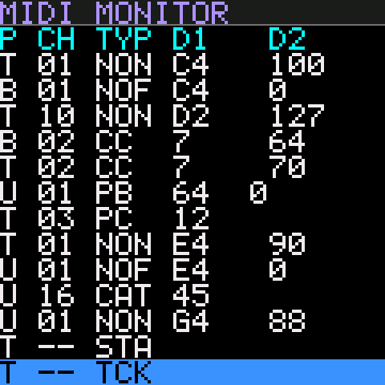
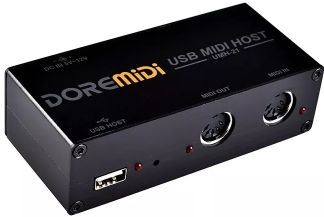

# FM-1 MIDI Processor



Custom firmware that turns the **M-VAVE FM-1** into a stand-alone MIDI processor: monitor, filter, remap, re-channelize and trigger MIDI without a computer.

- **[Help guide](https://midihax.github.io/fm1-midi-processor/html/)**: how every page and control works, with screen captures.
- **[Flash the firmware](https://midihax.github.io/fm1-midi-processor/html/flash.html)**: install it from desktop Chrome or Edge over USB. No software to install.

## Firmware

<!-- firmware: written by tools/make_site.py --firmware -->
**Latest version: 0.1.0** (build `d120f8ed27c9d6b5`, 2026-11-03 14:53 UTC)

- **[FM1-MidiProc.fwsc](https://github.com/MidiHax/fm1-midi-processor/raw/main/html/firmware/FM1-MidiProc.fwsc)**: the compiled firmware package, 459,316 bytes, for use with your own flasher.
- SHA-256: `4c119da121c813cd5f882390b9e1f3a474d92993207f3305d914090716c22834`
- Update identity `FM-1_8000014`, FM1 Open SDK family 7. Details in [manifest.json](https://github.com/MidiHax/fm1-midi-processor/raw/main/html/firmware/manifest.json).
<!-- /firmware -->

[](https://github.com/MidiHax/fm1-midi-processor/actions/workflows/build.yml)

GitHub builds the firmware from source on every change, with JieLi's 2.5.3 compiler. The build is byte-for-byte identical to the file above. Each run's firmware is available under [Actions](https://github.com/MidiHax/fm1-midi-processor/actions/workflows/build.yml), and tagged versions are under [Releases](https://github.com/MidiHax/fm1-midi-processor/releases).

## What it does

MIDI from **TRS MIDI IN** and **USB** passes through a pipeline and comes out of **USB MIDI OUT**:


- **MIDI Monitor:** a scrolling list of the last 100 messages. Colours show what the pipeline did: passed, blocked, remapped or triggered.
  - **Search** with OP1–OP5 by port, channel, type and data ranges.
  - **Shortcuts** turn the selected message into a rule or trigger.
- **Filters:** per port, pass or block each channel and each message type. Channel messages are set per channel.
- **Remaps:**
  - Message rules change note, CC or program numbers and set the output channel.
  - Channel rules move a port's channel to another channel.
- **Rule Builder (GLO):** build a remap rule by taking its input from one message and its output from another. Each can come from the monitor, the keys or the knobs.
- **Event Triggers:** an incoming message, or a range of values, sends a list of other messages, such as bank select and program changes for a whole rig.
- **Knobs:** KNOB 1–4 send a CC each, on the channel and CC number you choose, from any page.
- **Live Keys:** the FM-1's keys play notes with random velocity, and send program and bank changes.
- **MIDI clock:**
  - One input owns the clock, so clocks are never merged.
  - A metronome click plays on the headphone output, with its volume on MASTER.
  - The Clock Monitor shows the source, run state, BPM and elapsed time.
- **Patches:** 16 named patches.
  - Every setting can be dumped and loaded over SysEx, for backup and editing on a computer.

## Latency

Measured on 2026-11-03 with version 0.1.0 (build `a8c8fd4918ca4038`), using `tools/latency_test.py`. The FM-1 was connected over USB to a Windows 11 PC. Notes were sent to the FM-1's USB input and timed on their way back from its USB output.

**Inside the FM-1:** from a message arriving to the processed message being handed to USB.

| Test | Messages | Mean | Max | Lost |
|---|---|---|---|---|
| Single notes | 2,000 | 0.13 ms | 0.47 ms | 0 |
| Bursts of 8 notes | 4,800 | 0.18 ms | 0.79 ms | 0 |

Every message took under 0.5 ms with single notes, and under 1 ms in bursts.

**Round trip:** PC → FM-1 → PC. This includes the PC's own USB MIDI handling in both directions, so most of the time is spent on the computer.

| Test | Probes | Min | Median | 95% | 99% | Max |
|---|---|---|---|---|---|---|
| Single notes | 1,000 | 0.28 ms | 0.50 ms | 1.01 ms | 1.84 ms | 3.66 ms |
| Bursts of 8 notes, whole burst | 300 | 1.02 ms | 1.91 ms | 3.33 ms | 4.02 ms | 6.25 ms |

To repeat the test, close other MIDI software and run `python tools/latency_test.py`. Add `--burst 8` for bursts and `--count` to set the number of probes. Needs `python-rtmidi`.

## MIDI Connections

The [DoReMidi USB MIDI Host Box](https://www.doremidi.cn/h-pd-36.html) can be used to provide DIN MIDI in/out ports for the FM-1. With the USB Host Box, you have 2 inputs (1 DIN and 1 TRS) and 1 DIN output. The USB Host Box will also power the FM-1.

> [!NOTE]
> MIDI from the host box's DIN input reaches the FM-1 over USB. So on the FM-1 it appears as the USB port (U in the monitor).



## Repository

| Folder | Contents |
|---|---|
| `src/` | Firmware, built on the [FM1 Open SDK](https://github.com/m-vave/fm1_open) |
| `tools/` | USB flasher (`fm1_flash.py`), patch SysEx tool, screen designer, site builder, tests |
| `design/` | Screen designs, design decisions, patch and SysEx format |
| `html/` | The help site and flash page, published with GitHub Pages |

To build the firmware, you need the JieLi PI32 toolchain. Run:

```
set FM1_PI32_TOOLCHAIN=C:\JL\pi32
python tools\fm1_flash.py --build
```

`fm1_flash.py --build` builds the firmware and flashes it to a connected FM-1.

FM-1 MIDI Processor is unofficial firmware. It isn't made or supported by M-VAVE. Use it at your own risk.
